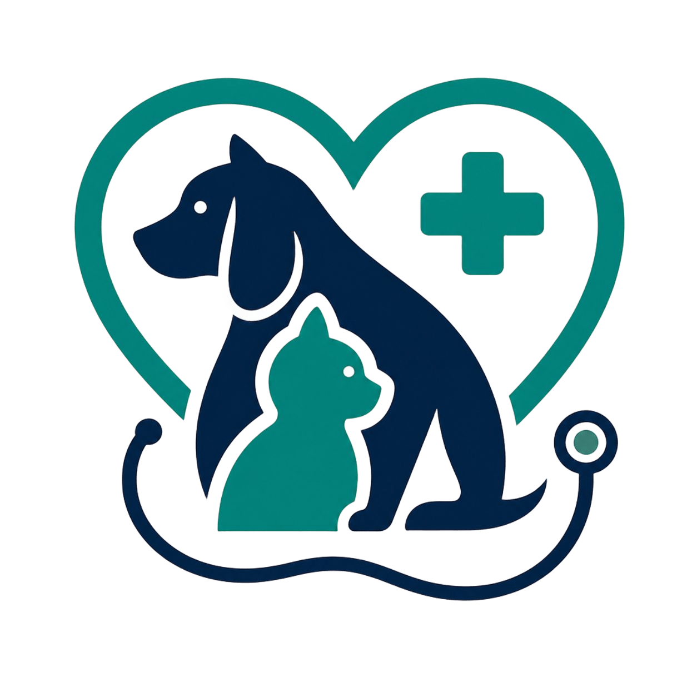

<p align="center">
  
</p>

<h1 align="center">PetCare Connect — Portal Web</h1>

<p align="center">
  Painel de gestão da clínica veterinária PetCare Connect, em React + TypeScript.<br/>
  Consome a API REST em Java (Spring Boot) e faz par com o aplicativo Android do tutor.
</p>

---

## Sobre o projeto

O PetCare Connect é um sistema de gestão para clínicas veterinárias dividido em três partes:

| Parte | Quem usa | Tecnologia | Repositório |
|---|---|---|---|
| **Portal Web** (este repositório) | Veterinário e Admin | React + TypeScript + Vite | este |
| **App Mobile** | Tutor | Android (Java, Retrofit) | _link do repositório do app_ |
| **API** | Os dois acima | Java 21 + Spring Boot + PostgreSQL | _link do repositório da API_ |

Regra de produto: **o tutor usa só o app** e **o web é só para Veterinário e Admin**. Se um tutor tentar entrar no portal, o sistema o orienta a usar o aplicativo.

```
        Banco de dados (PostgreSQL)
                 ↑
          API Spring Boot  (/api, porta 5000)
          ↑              ↑
   Portal Web        App Android
   (este repo)       (Retrofit)
```

Em produção, o build do React é servido pela própria API (pasta `static` do Spring), então site e API ficam na mesma URL e o front chama `/api` de forma relativa.

## Estado atual

O front está **funcionalmente completo** para o escopo definido e passou no roteiro de testes com o modo de exemplo (dados fictícios, sem backend). O que falta é conferência contra a API real, acabamento e deploy. Veja o [Roadmap](#roadmap-e-pendências).

## Funcionalidades

**Autenticação**
- Login com seleção de perfil (Veterinário ou Admin) e sessão por JWT
- Recuperação de senha em duas etapas (confirmação de identidade + token de redefinição)
- Rotas protegidas por perfil, com tela de acesso negado
- Logout automático quando o token expira (resposta 401 da API)

**Portal do Veterinário**
- Agenda de consultas, com conclusão do atendimento
- Registro de atendimento no histórico clínico do pet
- Vacinas: registro de aplicações e baixa de vacinas pendentes
- Histórico clínico em linha do tempo
- Emissão e atualização de relatórios clínicos (regra RN-003)
- Envio de avisos ao tutor, que o recebe no aplicativo
- Avisos recebidos, com contador de não lidos

**Painel Administrativo**
- Visão geral com totais e consultas por status
- Usuários: cadastro de tutores e veterinários, edição, ativação e desativação de acesso
- Pets: cadastro com validação, edição e bloqueio de nome repetido por tutor
- Consultas: agendamento com horários livres do veterinário, conclusão e desmarcação (regras RN-002 e RN-005)
- Relatórios: consulta de todos os relatórios (somente leitura)
- Avisos: publicar para todos, um tutor ou um veterinário; editar e apagar

## Tecnologias

- [React](https://react.dev/) e [TypeScript](https://www.typescriptlang.org/) (modo estrito)
- [Vite](https://vite.dev/)
- [React Router](https://reactrouter.com/) para rotas e rotas protegidas
- [Axios](https://axios-http.com/) para a comunicação com a API
- CSS puro, com variáveis de tema (sem biblioteca de UI)

## Começando

### Pré-requisitos

- **Node.js 20.19+** (ou 22+). Confira com `node -v`.
- Git
- Para rodar com dados reais: a API rodando em `http://localhost:5000` (veja o repositório da API). Sem ela, use o [modo de exemplo](#modo-de-exemplo-sem-backend).

> **Dica:** clone o projeto **fora do OneDrive** (por exemplo, `C:\dev`). O OneDrive sincroniza a `node_modules` e pode corromper a pasta `.git`.

### Clonar e instalar

O repositório tem o projeto dentro da subpasta `petcare-web/`. **Todos os comandos do npm rodam dentro dela.**

```bash
git clone https://github.com/SEU-USUARIO/petcare-connect-web.git
cd petcare-connect-web/petcare-web
npm install
```

### Rodar com a API real

```bash
npm run dev
```

Abra `http://localhost:5173`. O front chama `http://localhost:5000/api` (definido no `.env.development`). A API precisa liberar o CORS para `http://localhost:5173`.

### Modo de exemplo (sem backend)

O modo de exemplo troca a rede por um "servidor falso" dentro do próprio front. Ele responde a **todo o contrato da API**, com regras de negócio (RN-002, RN-003, RN-005), autenticação, permissões por perfil, avisos automáticos e persistência no `localStorage`. É a forma mais rápida de ver e testar as telas.

1. Crie o arquivo `petcare-web/.env.development.local` com uma linha:
   ```
   VITE_USE_MOCK=true
   ```
   (arquivos `*.local` não são versionados)
2. Rode `npm run dev`. Uma faixa amarela "MODO DE EXEMPLO · dados fictícios" aparece no canto da tela.
3. Para **restaurar os dados de exemplo**, abra o console do navegador (F12) e rode `petcareMockReset()`.
4. Para **voltar à API real**, apague o arquivo (ou troque para `false`) e reinicie o `npm run dev`.

**Contas do modo de exemplo**

| Login | Senha | Perfil | Observação |
|---|---|---|---|
| `vet_teste` | `Vet123!` | Veterinário | Dr. Carlos: vê Rex e Mia |
| `vet_camila` | `Vet123!` | Veterinário | Dra. Camila: vê Thor |
| `admin_teste` | `Admin123!` | Admin | |
| `tutor_teste` | `Tutor123!` | Tutor | Deve ser barrado no web |
| `joao_tutor` | `Tutor123!` | Tutor | |

> O modo de exemplo prova que o front é coerente com o contrato, **não** que a API real responde igual. Antes de entregar, sempre teste também contra a API real.

### Roteiro de teste manual

| O que testar | Resultado esperado |
|---|---|
| Entrar com `tutor_teste` | Mensagem "Utilize o aplicativo" |
| Veterinário abrir `/admin` na barra de endereço | Tela "Acesso negado" |
| Admin abrir `/veterinario` | Tela "Acesso negado" |
| Dr. Carlos: relatório do **Rex** | Erro da RN-003 (sem consulta realizada) |
| Dr. Carlos: concluir a consulta do Rex e refazer o relatório | Salva com sucesso |
| Dr. Carlos vs. Dra. Camila | Cada um vê só os seus pets e consultas |
| Admin: agendar com Dr. Carlos amanhã | O horário 08:00 não aparece (já ocupado) |
| Admin: desmarcar a consulta do Rex (menos de 24h) | Status "Não compareceu" (RN-005) |
| Admin: desmarcar a do Thor (daqui a 5 dias) | Status "Cancelada" |
| Admin: pet com nome repetido do mesmo tutor | Bloqueado |
| Admin: desativar `vet_camila` e tentar logar com ela | "Usuário desativado." |
| Recuperar senha (`vet_teste` + `carlos@exemplo.com`) | Fluxo completo e login com a nova senha |
| F5 em qualquer tela | Sessão e dados mantidos |

### Build de produção

```bash
npm run build
```

Roda a checagem de tipos do TypeScript (`tsc -b`) e depois o `vite build`. A saída fica em `petcare-web/dist/`. **O build precisa passar sem erros antes de qualquer commit.**

### Variáveis de ambiente

| Arquivo | Variável | Valor | Versionado |
|---|---|---|---|
| `.env.development` | `VITE_API_URL` | `http://localhost:5000/api` | sim |
| `.env.production` | `VITE_API_URL` | `/api` | sim |
| `.env.development.local` | `VITE_USE_MOCK` | `true` para o modo de exemplo | **não** |

Nunca coloque segredos (chaves, senhas) nesses arquivos.

## Estrutura de pastas

```
petcare-web/
├── index.html
├── package.json
├── .env.development
├── .env.production
├── public/
└── src/
    ├── api/
    │   ├── http.ts            ← instância Axios (JWT automático, tratamento de 401, getErro)
    │   ├── auth.ts            ← login, recuperação e nova senha
    │   ├── session.ts         ← leitura e gravação da sessão no localStorage
    │   ├── clinica.ts         ← pets, consultas, vacinas, histórico, relatórios, avisos
    │   └── admin.ts           ← usuários, pets e avisos (ações do admin)
    ├── components/            ← AuthCard, PainelLayout, Modal, SeletorPet, Vazio
    ├── contexts/
    │   └── AuthContext.tsx    ← usuário logado disponível em todo o app
    ├── mock/                  ← modo de exemplo (servidor falso)
    │   ├── index.ts           ← adaptador do Axios e ativação
    │   ├── db.ts              ← dados de exemplo (seed) e persistência
    │   ├── comum.ts           ← DTOs, visibilidade por perfil e regras compartilhadas
    │   └── rotas/             ← auth, usuarios, pets, consultas, clinico, avisos
    ├── pages/
    │   ├── auth/              ← Login, RecuperarSenha, NovaSenha
    │   ├── veterinario/       ← VeterinarioPage, useVetData e secoes/
    │   ├── admin/             ← AdminPage, useAdminData, secoes/ e subpastas de apoio
    │   │   ├── secoes/        ← Inicio, Usuarios, Pets, Consultas, Relatorios, Avisos
    │   │   ├── pets/          ← validarPet, CamposPet
    │   │   ├── consultas/     ← useHorarios, FormAgendamento
    │   │   └── avisos/        ← montarAviso, CamposAviso
    │   └── NaoAutorizado.tsx
    ├── routes/
    │   └── ProtectedRoute.tsx ← guarda de rotas por perfil
    ├── styles/                ← global.css, auth.css, painel.css
    ├── types/
    │   └── index.ts           ← tipos compartilhados (Usuario, Pet, Consulta...)
    └── utils/
        ├── datas.ts           ← conversão e ordenação de datas
        └── statusConsulta.ts  ← rótulos e cores de status
```

## Rotas

| Rota | Acesso | Descrição |
|---|---|---|
| `/` | Pública | Login (quem já está logado é levado ao seu painel) |
| `/recuperar-senha` | Pública | Confirmação de identidade |
| `/nova-senha` | Pública (exige o token da etapa anterior) | Definição da nova senha |
| `/veterinario` | Veterinário | Portal do veterinário |
| `/admin` | Admin | Painel administrativo |
| `/nao-autorizado` | Pública | Perfil sem permissão para a página |

## Contrato da API

Todas as respostas seguem o envelope:

```json
{ "sucesso": true, "mensagem": "opcional", "dados": {} }
```

Erros vêm como `{ "sucesso": false, "mensagem": "..." }` com status 4xx. O front lê o campo `mensagem`. Token ausente, inválido ou expirado deve responder **401** (o front desloga sozinho). Perfil sem permissão responde **403**.

Convenções: JSON em camelCase, datas em `dd/MM/yyyy`, horas em `HH:mm`, perfis `Tutor` | `Veterinario` | `Admin`, status de consulta `Marcada` | `Realizada` | `Cancelada` | `NaoCompareceu`. Os caminhos têm a capitalização exata abaixo (o Spring diferencia maiúsculas e minúsculas).

| Área | Endpoint | Perfis | Observação |
|---|---|---|---|
| Auth | `POST /Auth/login` | público | `{ login, senha, perfil }` → `{ token, usuarioId, nome, login, perfil }`. A API devolve o perfil **real** da conta |
| Auth | `POST /Auth/recuperar-senha` | público | `{ login, email }` → `{ token }` (uso único, 15 min) |
| Auth | `POST /Auth/nova-senha` | público | `{ login, novaSenha, token }` |
| Auth | `POST /Auth/cadastro` | público | Usado só pelo **app** (cria sempre `Tutor`) |
| Usuários | `GET /Usuarios` · `POST /Usuarios` | Admin | Nunca devolve senha ou hash |
| Usuários | `PUT /Usuarios/{id}` | Admin | Edita nome, e-mail, telefone, endereço, convênio, registro |
| Usuários | `PATCH /Usuarios/{id}/ativo` | Admin | Corpo é um **boolean puro** (`true`/`false`) |
| Pets | `GET /Pets` | todos | Filtrado por perfil |
| Pets | `POST /Pets` · `PATCH /Pets/{id}` | Admin (e Tutor) | Corpo: `nome, tipo, raca, idade, peso, tutorId` |
| Consultas | `GET /Consultas` | todos | Veterinário: só as suas |
| Consultas | `GET /Consultas/horarios-disponiveis?veterinarioId=&data=` | Admin, Tutor | `dados: string[]` de horários livres |
| Consultas | `POST /Consultas` | Admin, Tutor | `{ petId, veterinarioId, data, hora }`; regra RN-002 |
| Consultas | `PATCH /Consultas/{id}/status?status=&obs=` | Veterinário, Admin | Sem corpo (parâmetros na query) |
| Consultas | `POST /Consultas/{id}/cancelar` | Admin, Tutor | Regra RN-005 (menos de 24h vira `NaoCompareceu`) |
| Vacinas | `GET /Vacinas/{petId}` · `POST /Vacinas` | todos / Vet, Admin | |
| Vacinas | `PATCH /Vacinas/{id}/aplicar?data=&obs=` | Veterinário, Admin | Baixa de vacina pendente |
| Histórico | `GET /Historico/{petId}` · `POST /Historico` | todos / Vet, Admin | |
| Relatórios | `GET /Relatorios` · `POST /Relatorios` | todos / Vet, Admin | `{ petId, texto }`; regra RN-003 |
| Avisos | `GET /Avisos` | todos | Filtrado por perfil; `lido` é por usuário |
| Avisos | `POST /Avisos` | Veterinário, Admin | `{ titulo, texto, tipo, tutorId, veterinarioId, petId }` |
| Avisos | `PUT /Avisos/{id}` · `DELETE /Avisos/{id}` | Admin | Editar zera a leitura |
| Avisos | `POST /Avisos/{id}/lido` | todos | Marca como lido para o usuário logado |

O front **não** chama `/Admin/estatisticas`: os totais do painel admin são calculados a partir das listas. Por isso, para o Admin, `GET /Usuarios`, `/Pets`, `/Consultas`, `/Relatorios` e `/Avisos` precisam devolver as listas completas.

### Regras de negócio

- **RN-002:** não pode haver duas consultas do mesmo veterinário na mesma data e hora, exceto se a anterior estiver `Cancelada`.
- **RN-003:** só é possível emitir relatório de um pet com ao menos uma consulta `Realizada`.
- **RN-005:** cancelar com menos de 24h de antecedência registra `NaoCompareceu`; com 24h ou mais, `Cancelada`.

## Convenções do projeto

- **TypeScript estrito.** Tipos entram com `import type`. Variável ou import não usado quebra o build (`TS6133`).
- **Toda chamada de API passa por `src/api/`.** As telas não usam `axios` diretamente. Erros são mostrados com `getErro(e)` ou com `r.mensagem` quando `r.sucesso` é falso.
- **Datas:** a API usa `dd/MM/yyyy`; os `<input type="date">` usam `yyyy-MM-dd`. Converta com `utils/datas.ts`.
- **Estilos dos painéis:** use `pbtn`, `pbtn-primary`, `pbtn-secondary`, `pbtn-sm`, `card`, `tag-*`, `form-group`. **Não use a classe `.btn` nos painéis**: ela é do login e tem `width: 100%`.
- **Padrão das seções:** cada aba do painel é um componente em `secoes/` que recebe `dados`, `recarregar` e `avisar` (toast com prefixos ✅ ⚠️ ❌). Os dados vêm de `useVetData` ou `useAdminData`.
- **Perfis e status** com a grafia exata dos contratos acima.
- **Commits** pequenos, em português, um assunto por commit, no estilo `feat:`, `fix:`, `refactor:`, `docs:`, `chore:`, `style:`.

## Como continuar o desenvolvimento

**Adicionar uma aba nova ao painel (veterinário ou admin)**
1. Crie `secoes/MinhaSecao.tsx`, copiando a estrutura de uma seção existente.
2. Em `VeterinarioPage.tsx` ou `AdminPage.tsx`, inclua o id no tipo `Aba`, uma entrada em `ABAS` e a linha de renderização.

**Adicionar um endpoint**
1. Tipo novo (se preciso) em `src/types/index.ts`.
2. Método em `src/api/clinica.ts` ou `src/api/admin.ts`.
3. A rota correspondente em `src/mock/rotas/` (para o modo de exemplo continuar fiel).
4. A linha na tabela de contrato deste README, e **avise quem mantém a API**.

**Antes de cada commit:** `npm run build` precisa terminar com `✓ built`.

**Trabalho em dupla:** rode `git pull --rebase` antes de começar e antes de enviar (`git push`). Combine quem mexe em qual arquivo para evitar conflito.

## Segurança

- A proteção de rotas do React é **apenas de interface**. Quem altera o `localStorage` consegue abrir a tela, mas não consegue dados. Quem protege os dados é a API, validando o perfil do token em cada endpoint.
- O token JWT fica no `localStorage` (`petcare_token` e `petcare_user`).
- A recuperação de senha usa token de uso único e curta duração. Sem envio de e-mail, quem souber login e e-mail de uma conta ainda consegue redefinir a senha. Enviar o link por e-mail é a evolução natural.
- No modo de exemplo, senhas ficam em texto puro no `localStorage`. É só para desenvolvimento e demonstração.

## Deploy

Hospedagem planejada: **Render** (Docker) para a aplicação e **Neon** (PostgreSQL) para o banco.

1. O **Dockerfile fica no repositório da API** e é multi-stage: (1) clona **este** repositório e roda `npm ci && npm run build` em `petcare-web/`; (2) copia o `dist/` para `src/main/resources/static`; (3) compila o Spring Boot; (4) gera a imagem final.
2. O Spring devolve o `index.html` para as rotas do React (`/`, `/admin`, `/veterinario`, `/recuperar-senha`, `/nova-senha`, `/nao-autorizado`) e serve `/assets/*` como arquivos estáticos.
3. Variáveis de ambiente da API: `DB_URL`, `DB_USER`, `DB_PASSWORD`, `JWT_SECRET` e `CORS_ORIGINS`. **Nunca** coloque esses valores no repositório.
4. No Neon, a URL JDBC precisa de `?sslmode=require`.
5. O Dockerfile clona o `main` deste repositório: **só entra no deploy o que estiver enviado ao GitHub**.
6. Como o `.env.production` usa `VITE_API_URL=/api`, não é preciso alterar nada no código para publicar.

Hospedagem gratuita costuma "dormir" por inatividade: abra o site uns 10 minutos antes de uma apresentação.

## Problemas comuns

| Sintoma | Causa e solução |
|---|---|
| `npm error Missing script: "dev"` | Você rodou fora da subpasta. Entre em `petcare-web` e rode de novo |
| `npm run build` falha com erro `TS...` | O TypeScript é estrito. Leia a mensagem (arquivo e linha). Os mais comuns: import não usado (`TS6133`) e falta de `import type` |
| Login mostra "Servidor offline" | A API não está rodando em `localhost:5000`, ou o `VITE_API_URL` está errado. Ou use o modo de exemplo |
| Erro de CORS no console | A API precisa liberar `http://localhost:5173` (`CORS_ORIGINS`) |
| Cai no login depois de uma ação | A API respondeu 401 (token expirado ou inválido): o front desloga de propósito |
| Dados estranhos ou mock ligado sem querer | Apague `.env.development.local` e reinicie, ou rode `petcareMockReset()` no console |
| Botão ocupando a largura inteira | Foi usada a classe `btn`. Nos painéis use `pbtn` |
| "Editei o arquivo e nada mudou" | Confira se salvou e se está editando o arquivo da pasta certa |

## Roadmap e pendências

**Pronto**
- [x] Estrutura do projeto, cliente Axios com JWT e tipos
- [x] Login, recuperação de senha e nova senha
- [x] Rotas protegidas por perfil e tela de acesso negado
- [x] Portal do Veterinário completo
- [x] Painel Admin completo (usuários, pets, consultas, relatórios e avisos)
- [x] Modo de exemplo com todo o contrato e as regras de negócio

**Pendente**
- [ ] **Teste de ponta a ponta contra a API Java** (o mais importante)
- [ ] Título e ícone da aba do navegador (`index.html` e `public/`)
- [ ] Remover resíduos: `authApi.cadastro` em `src/api/auth.ts` e `CadastroRequest` em `src/types/index.ts`
- [ ] Conferir responsividade em celular (cabeçalho do painel e barra de abas)
- [ ] Rodar o lint (`npm run lint`, se o script existir)
- [ ] Deploy no Render + Neon
- [ ] Preencher os links e a equipe deste README
- [ ] Envio do link de redefinição de senha por e-mail

**Opcional**
- [ ] Trocar `window.confirm` por um modal próprio (o componente `Modal` já existe)
- [ ] Usar `utils/statusConsulta.ts` na Agenda do veterinário (hoje tem constantes duplicadas)
- [ ] Barra lateral nos painéis, como no sistema do semestre anterior
- [ ] Landing page de apresentação

## Repositórios relacionados

- **App Mobile (Android):** _adicione o link_
- **API (Java / Spring Boot):** _adicione o link_

## Equipe

- _Gabriel_ (sobrenome)
- _Luana_ (sobrenome)

Projeto acadêmico.
