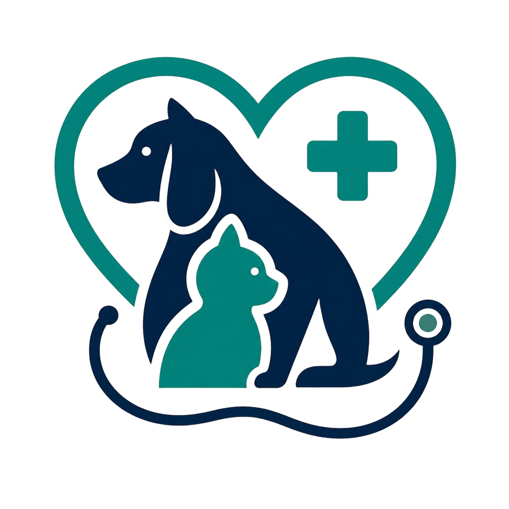

<p align="center">
  
</p>

<h1 align="center">PetCare Connect — Portal Web</h1>

<p align="center">
  Painel de gestão da clínica veterinária PetCare Connect, feito em React + TypeScript.<br/>
  Consome a API REST em .NET e faz par com o aplicativo Android do tutor.
</p>

---

## Sobre o projeto

O PetCare Connect é um sistema de gestão para clínicas veterinárias dividido em três partes:

| Parte | Público | Tecnologia |
|---|---|---|
| **Portal Web** (este repositório) | Veterinários e Administradores | React + TypeScript + Vite |
| **App Mobile** | Tutores | Android (Java) |
| **API** | Os dois clientes acima | ASP.NET Core (REST + JWT) |

O tutor acompanha seus pets pelo aplicativo. A equipe da clínica trabalha pelo portal web: o veterinário cuida de agenda, atendimentos, vacinas, relatórios e avisos, e o administrador gerencia usuários, pets, consultas e comunicados.

> **Contas de Tutor não acessam o portal web.** Se um tutor tentar entrar, o sistema o orienta a usar o aplicativo.

## Arquitetura

```
        Banco de dados
              ↑
         API .NET  (/api)
        ↑            ↑
 Portal Web       App Android
 (este repo)      (Retrofit)
```

Em desenvolvimento, o front roda no Vite (`localhost:5173`) e chama a API em `localhost:5000`. Em produção, o build do React é servido pela própria API (pasta `wwwroot`), então site e API ficam na mesma URL e o front chama `/api` de forma relativa.

## Funcionalidades

**Autenticação**
- Login com seleção de perfil (Veterinário ou Admin) e sessão por JWT
- Recuperação de senha em duas etapas (confirmação de identidade + token de redefinição)
- Rotas protegidas por perfil, com tela de acesso negado
- Logout automático quando o token expira (resposta 401 da API)

**Portal do Veterinário**
- Agenda de consultas, com conclusão do atendimento
- Registro de atendimento no histórico clínico do pet
- Vacinas: registro de aplicações e baixa de vacinas pendentes
- Histórico clínico em linha do tempo
- Emissão e atualização de relatórios clínicos
- Envio de avisos ao tutor, que o recebe no aplicativo
- Avisos recebidos, com contador de não lidos

**Painel Administrativo**
- Visão geral com totais e consultas por status
- Usuários: cadastro de tutores e veterinários, edição, ativação e desativação de acesso

## Tecnologias

- [React](https://react.dev/) e [TypeScript](https://www.typescriptlang.org/)
- [Vite](https://vite.dev/)
- [React Router](https://reactrouter.com/) para rotas e rotas protegidas
- [Axios](https://axios-http.com/) para a comunicação com a API
- CSS puro, com variáveis de tema (sem biblioteca de UI)

## Pré-requisitos

- Node.js 20.19 ou superior (recomendada a LTS mais recente)
- A API do PetCare Connect rodando em `http://localhost:5000`

## Como rodar

```bash
git clone https://github.com/SEU-USUARIO/petcare-connect-web.git
cd petcare-connect-web/petcare-web

npm install
npm run dev
```

Abra `http://localhost:5173`.

Para gerar o build de produção (já roda a checagem de tipos do TypeScript):

```bash
npm run build
```

### Variáveis de ambiente

| Arquivo | Variável | Valor |
|---|---|---|
| `.env.development` | `VITE_API_URL` | `http://localhost:5000/api` |
| `.env.production` | `VITE_API_URL` | `/api` |

Se a sua API usar outra porta, altere o `.env.development`.

## Estrutura de pastas

```
petcare-web/
├── .env.development
├── .env.production
└── src/
    ├── api/
    │   ├── http.ts            ← instância Axios (JWT automático, tratamento de 401)
    │   ├── auth.ts            ← login, recuperação e nova senha
    │   ├── session.ts         ← leitura e gravação da sessão
    │   ├── clinica.ts         ← pets, consultas, vacinas, histórico, relatórios, avisos
    │   └── admin.ts           ← usuários
    ├── components/            ← AuthCard, PainelLayout, Modal, SeletorPet, Vazio
    ├── contexts/
    │   └── AuthContext.tsx    ← usuário logado disponível em todo o app
    ├── pages/
    │   ├── auth/              ← Login, RecuperarSenha, NovaSenha
    │   ├── veterinario/       ← VeterinarioPage, useVetData e secoes/
    │   ├── admin/             ← AdminPage, useAdminData e secoes/
    │   └── NaoAutorizado.tsx
    ├── routes/
    │   └── ProtectedRoute.tsx ← guarda de rotas por perfil
    ├── styles/                ← global.css, auth.css, painel.css
    ├── types/                 ← tipos compartilhados (Usuario, Pet, Consulta...)
    └── utils/
        └── datas.ts           ← conversão e ordenação de datas
```

## Rotas

| Rota | Acesso | Descrição |
|---|---|---|
| `/` | Pública | Login |
| `/recuperar-senha` | Pública | Confirmação de identidade |
| `/nova-senha` | Pública (exige token) | Definição da nova senha |
| `/veterinario` | Veterinário | Portal do veterinário |
| `/admin` | Admin | Painel administrativo |
| `/nao-autorizado` | Pública | Perfil sem permissão para a página |

## Contrato esperado da API

Todas as respostas seguem o envelope:

```json
{ "sucesso": true, "mensagem": "opcional", "dados": {} }
```

Erros devem vir como `{ "sucesso": false, "mensagem": "..." }`. Token inválido ou expirado deve responder **401**.

| Área | Endpoint | Uso |
|---|---|---|
| Auth | `POST /Auth/login` | `{ login, senha, perfil }` → `dados: { token, usuarioId, nome, login, perfil }` |
| Auth | `POST /Auth/recuperar-senha` | `{ login, email }` → `dados: { token }` |
| Auth | `POST /Auth/nova-senha` | `{ login, novaSenha, token }` |
| Veterinário | `GET /Consultas` | Consultas do veterinário do token |
| Veterinário | `PATCH /Consultas/{id}/status?status=&obs=` | Atualiza o status |
| Veterinário | `GET /Pets` | Pets |
| Veterinário | `GET /Vacinas/{petId}` · `POST /Vacinas` | Listar e registrar |
| Veterinário | `PATCH /Vacinas/{id}/aplicar?data=&obs=` | Baixa de vacina pendente |
| Veterinário | `GET /Historico/{petId}` · `POST /Historico` | Listar e adicionar |
| Veterinário | `GET /Relatorios` · `POST /Relatorios` | Listar e salvar |
| Veterinário | `GET /Avisos` · `POST /Avisos` · `POST /Avisos/{id}/lido` | Avisos |
| Admin | `GET /Usuarios` · `POST /Usuarios` | Listar e criar (nunca devolver senha ou hash) |
| Admin | `PUT /Usuarios/{id}` | Editar dados |
| Admin | `PATCH /Usuarios/{id}/ativo` | Corpo é um boolean puro |

Convenções: datas em `dd/MM/yyyy` e status de consulta em `Marcada`, `Realizada`, `Cancelada` ou `NaoCompareceu` (os mesmos do app mobile).

## Segurança

- A proteção de rotas do React é **apenas de interface**. Quem altera o `localStorage` consegue abrir a tela, mas não consegue dados.
- Quem protege os dados é a API: cada endpoint deve validar o perfil do token (por exemplo, `[Authorize(Roles = "Admin")]`).
- O token JWT fica no `localStorage` (`petcare_token` e `petcare_user`). Não coloque segredos no front nem em arquivos `.env` versionados.
- A recuperação de senha usa token de uso único com validade curta. Sem envio de e-mail, quem souber login e e-mail de uma conta ainda consegue redefinir a senha. Enviar o link por e-mail é a evolução natural.

## Deploy integrado com a API .NET

O front é publicado dentro da pasta `wwwroot` da API:

1. Gere o build:
   ```bash
   cd petcare-web
   npm run build
   ```
2. Copie o conteúdo de `petcare-web/dist/` para a pasta `wwwroot` da API.
3. Confirme que o `Program.cs` da API serve os arquivos e as rotas do React:
   ```csharp
   app.UseDefaultFiles();
   app.UseStaticFiles();
   app.UseAuthentication();
   app.UseAuthorization();
   app.MapControllers();
   app.MapFallbackToFile("index.html"); // permite recarregar rotas como /admin
   ```
4. Publique a API (`dotnet publish -c Release`) e suba para a hospedagem escolhida.

Como o `.env.production` usa `/api`, não é preciso alterar nada no código na hora do deploy.

## Roadmap

- [x] Estrutura do projeto, cliente Axios com JWT e tipos
- [x] Login, recuperação de senha e nova senha
- [x] Rotas protegidas por perfil
- [x] Portal do Veterinário completo
- [x] Painel Admin: início e usuários
- [ ] Painel Admin: pets
- [ ] Painel Admin: consultas (agendamento com horários livres)
- [ ] Painel Admin: relatórios e avisos
- [ ] Envio de link de redefinição de senha por e-mail
- [ ] Build integrado na `wwwroot` e hospedagem

## Repositórios relacionados

- **App Mobile (Android):** _adicione o link do repositório_
- **API (.NET):** _adicione o link do repositório_

## Equipe

- _Seu nome_
- _Luana_ (sobrenome)

Projeto acadêmico.